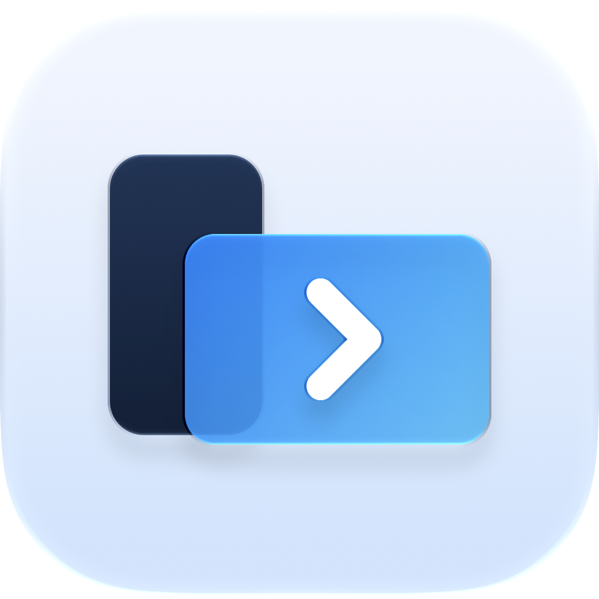

<div align="center">



# anmacgamer

**Low-latency Android mirroring, key/gamepad mapping, and Blueprint / TypeScript automation for macOS**

[](https://github.com/wyb-070110/anmacgammer/releases)
[](LICENSING.md)
[](#requirements)

[简体中文](README.md) · English

[Releases](https://github.com/wyb-070110/anmacgammer/releases) · [User guide](docs/README.md) · [Port notes](docs/macos-port.md) · [Changelog](CHANGELOG.md)


</div>

**anmacgamer**, maintained by [@wyb-070110](https://github.com/wyb-070110), is a native macOS Android mirroring and gaming automation app built upon the upstream project [NuoRan/GameScrcpy](https://github.com/NuoRan/GameScrcpy) (Apache-2.0), with mirroring concepts originally inspired by [scrcpy](https://github.com/Genymobile/scrcpy). It mirrors your Android phone to your Mac with low latency, lets you place keyboard, mouse and controller bindings right on the game picture, supports macOS trackpad gestures, and runs automation logic written as blueprints (nodes and wires) or TypeScript with image search, color matching, OCR, voice commands, and scheduled tasks.

The user interface is available in Simplified Chinese and English, and language pack extensions can add more languages.

## Features

- **Low-latency video and audio**: VideoToolbox hardware decoding (H.264, H.265, plus AV1 through dav1d) drawn directly through Qt RHI on Metal (NV12, P010 and planar YUV 4:2:0) paced to the display refresh; phone audio playback through SDL3 (Android 11 and later).
- **Connections and touch**: USB cable (bundled `adb`, plus libusb hotplug watching and AOA v2 HID touch); wireless debugging paired with a six-digit code or QR code; WiFi direct (UDP with Reed-Solomon forward error correction and automatic session resumption); companion app over BSD sockets and Bonjour (`_gs-companion._tcp`).
- **Key mapping, gamepads and trackpad**: keyboard and mouse mapping without needing Input Monitoring permission, direct Mac keyboard typing (including Chinese) without popping up the phone's soft keyboard, Xbox / PS4 / PS5 controller support with rumble, and two-finger trackpad swipes (direct, page turn, natural fling, and scroll wheel modes).
- **Native macOS experience**: Liquid Glass design following system light/dark appearance and Reduce Transparency; native menu bar, status bar item and notifications; aspect-locked mirror windows or a multi-device grid, recording and MP4 export, file and app management, launching apps on an independent virtual display, and end-to-end latency measurement.
- **Blueprints, scripts, OCR and speech**: two-way blueprint / TypeScript editing, script execution isolated in a `sandbox_init`-confined `gs-scripthost` process, text recognition via the macOS Vision framework, speech synthesis and on-device voice command recognition via `AVSpeechSynthesizer` and `SFSpeechRecognizer`, and the `gs` command-line tool.
- **AI, local MCP and extensions**: AI assistant API keys stored in the macOS Keychain; local MCP server over a Unix domain socket for Claude, Cursor and other AI tools; `.gsext` / `.gsbundle` packages, `.dylib` native extensions (Mach-O import inspection and out-of-process `gs-exthost` sandbox confinement), IOKit `/dev/cu.*` serial port access, and `gamescrcpy://` URL handling.

> Not yet available on macOS: HDMI capture cards, Bluetooth LE peripherals, and custom extension video shader filters. See [docs/macos-port.md](docs/macos-port.md) for details.

## Requirements

| | |
|:--|:--|
| Mac | macOS 14 Sonoma or later, on Apple silicon or Intel |
| Phone | Android 9 or later; audio forwarding and wireless pairing require Android 11 or later |
| Connection | A USB cable, or Wi-Fi / Ethernet on the same local network as the Mac |

## Install & getting started

1. Download the latest universal `.dmg` from [Releases](https://github.com/wyb-070110/anmacgammer/releases), open it, and drag the app to **Applications**.
2. On first launch (unsigned beta builds), **right-click the app in Applications → Open** (if macOS reports it as damaged, run once in Terminal: `xattr -dr com.apple.quarantine /Applications/GameScrcpy.app`).
3. On your phone, enable **Developer options** and **USB debugging** (or **Wireless debugging**), then connect via USB or pair under Wireless debugging on the **Devices** page.
4. Click **Mirror** on the **Devices** page; press `F1` at any time for the built-in illustrated help.

## Building from source

### 1. Install dependencies

```bash
xcode-select --install
brew install cmake ninja openssl@3 ffmpeg sdl3 libusb android-platform-tools
```

Install **Qt 6.10.3 for macOS** at `~/Qt/6.10.3/macos` (or pass `-DCMAKE_PREFIX_PATH=<path>` when configuring).

### 2. Configure, build and test

```bash
# Build the full macOS app bundle and run tests
cmake --preset mac-app
cmake --build --preset mac-app
ctest --preset mac-app

# Try the mirror window without a phone
./build/mac-app/bin/GameScrcpy.app/Contents/MacOS/GameScrcpy --demo-device tests/data/video/emulator_h265.media
```

To build and test only the Qt-free core libraries:

```bash
cmake --workflow --preset posix-core
```

For universal release `.dmg` builds (`arm64` + `x86_64`, macOS 14+, bundling LGPL dependencies and `adb`), see `tools/build_macos_deps.sh` and `packaging/macos/package.sh`. Settings, profiles, extensions and logs live in `~/Library/Application Support/GameScrcpy`.

## Documentation

| Topic | Where |
|:--|:--|
| User guide (same pages as `F1` in the app) | [docs/README.md](docs/README.md) |
| macOS port notes & architecture | [docs/macos-port.md](docs/macos-port.md) · [docs/architecture.md](docs/architecture.md) |
| Script API | [sdk/docs](sdk/docs/README.md) |
| Writing extensions | [docs/extensions](docs/extensions/README.en.md) |
| Protocol | [protocol/SPEC.md](protocol/SPEC.md) |
| Contributing guidelines | [CONTRIBUTING.en.md](CONTRIBUTING.en.md) |

## Feedback & security

- Issues and feature requests: [GitHub Issues](https://github.com/wyb-070110/anmacgammer/issues). Attach the archive exported from "Settings > About > Export diagnostics" when reporting a bug.
- Report security issues privately via the repository's [GitHub Security page](https://github.com/wyb-070110/anmacgammer/security/advisories/new) as described in [SECURITY.md](SECURITY.md).

## License and attribution

Code written for **anmacgamer** on macOS is released under the [GNU GPL 3.0 or later](LICENSES/GPL-3.0-or-later.txt), while code kept from upstream remains under the [Apache License 2.0](LICENSE); the distributed macOS application as a whole is offered under **GPL 3.0 or later**. See [LICENSING.md](LICENSING.md) for full details.

- **Upstream source**: Built upon and adapted from [NuoRan/GameScrcpy](https://github.com/NuoRan/GameScrcpy) (Apache License 2.0), with attribution and thanks to the upstream author.
- **[scrcpy](https://github.com/Genymobile/scrcpy)**: the pioneer of low-latency Android mirroring that inspired the design.
- Third-party open-source components (Qt, FFmpeg, dav1d, SDL3, OpenSSL, libusb, QuickJS-ng, TypeScript, QWindowKit, nlohmann/json, miniz, QR Code generator, Lucide, doctest, tl::expected), their versions and licenses are listed in [third_party/README.md](third_party/README.md), [LICENSING.md](LICENSING.md), and in the app under "Settings > About > Open-source licenses".
