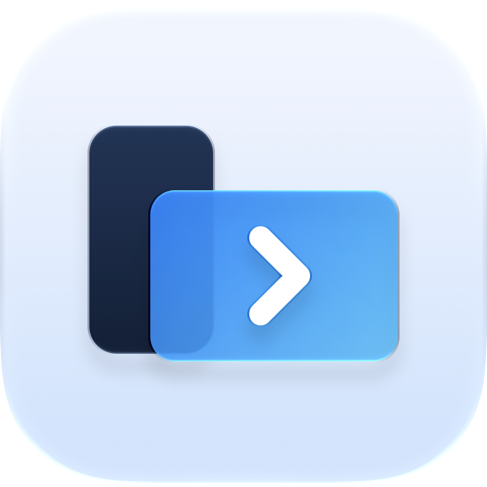

<div align="center">



# anmacgamer

**在 macOS 上低延迟投屏控制安卓手机，支持键鼠手柄映射、蓝图与 TypeScript 自动化**

[](https://github.com/wyb-070110/anmacgammer/releases)
[](LICENSING.md)
[](#系统要求)

简体中文 · [English](README.en.md)

[下载发布版](https://github.com/wyb-070110/anmacgammer/releases) · [使用帮助](docs/README.md) · [移植说明](docs/macos-port.md) · [更新日志](CHANGELOG.md)


</div>

**anmacgamer** 由 [@wyb-070110](https://github.com/wyb-070110) 维护，是基于上游项目 [NuoRan/GameScrcpy](https://github.com/NuoRan/GameScrcpy)（Apache-2.0）移植并深度适配的原生 macOS 安卓投屏与操控工具（通信与投屏思路亦致敬 [scrcpy](https://github.com/Genymobile/scrcpy)）。它把安卓手机的画面低延迟地投到 Mac 上，支持在画面上直接摆放键鼠与手柄键位、双指触控板滑动，并用蓝图（节点和连线）或 TypeScript 编写识图、找色、OCR、语音命令与定时任务逻辑。

## 主要功能

- **低延迟画面与声音**：VideoToolbox 硬件解码（H.264、H.265，AV1 由 dav1d 解码）与 Qt RHI（Metal）直接绘制，画面对齐屏幕刷新均匀呈现，支持 NV12、P010 与 YUV 4:2:0；SDL3 播放手机声音（Android 11 及以上）。
- **多种连接与触控**：USB 数据线（内置 adb，支持 libusb 热插拔与 AOA v2 HID 触控）；无线调试（配对码或二维码扫码配对）；WiFi 直连（UDP 加 Reed-Solomon 纠删码，断线自动续连）；手机伴侣应用经 BSD 套接字与 Bonjour 发现连接。
- **键鼠映射、手柄与触控板**：免“输入监控”权限的键位映射、Mac 键盘中英文直输（不弹手机软键盘）、Xbox / PS4 / PS5 手柄与震动支持；双指触控板支持跟手、翻页、自然甩动与滚轮四种滑动模式。
- **原生 macOS 体验**：Liquid Glass 界面风格，跟随系统深浅色与降低透明度设置；原生菜单栏、状态栏图标与通知；独立投屏窗口（缩放保持手机比例）或宫格同屏、录像与 MP4 导出、文件与应用管理、独立虚拟屏幕启动应用、端到端延迟测量。
- **蓝图、脚本、OCR 与语音**：蓝图与 TypeScript 双向转换，脚本运行在 `sandbox_init` 隔离的 `gs-scripthost` 进程中；接入 macOS Vision 框架实现中英文等文字识别；接入 `AVSpeechSynthesizer` 与 `SFSpeechRecognizer` 支持语音朗读与本机语音命令识别；内置命令行工具 `gs`。
- **AI、本地 MCP 与扩展系统**：AI 助手密钥保存在 macOS 钥匙串（Keychain）中；本地 MCP 服务经 Unix 套接字连接 Claude、Cursor 等工具；支持 `.gsext` / `.gsbundle` 扩展包、`.dylib` 原生扩展（Mach-O 导入检查与独立 `gs-exthost` 沙箱隔离）、IOKit `/dev/cu.*` 串口外设与 `gamescrcpy://` 链接唤起。

> 当前暂未接入的功能：HDMI 采集卡、低功耗蓝牙（BLE）外设与扩展自定义着色器画面滤镜，详见 [docs/macos-port.md](docs/macos-port.md)。

## 系统要求

| 项目 | 要求 |
|:--|:--|
| 电脑 | macOS 14 Sonoma 或更高版本，支持 Apple 芯片（M 系列）与 Intel Mac |
| 手机 | Android 9 或更高版本；声音转发与无线调试配对需要 Android 11 或更高版本 |
| 连接 | USB 数据线，或与 Mac 在同一局域网的 Wi-Fi / 有线网络 |

## 安装与快速开始

1. 从 [Releases](https://github.com/wyb-070110/anmacgammer/releases) 下载最新的通用版 `.dmg`，打开后将应用拖入“应用程序”。
2. 首次打开若提示未签名，请在“应用程序”中**右键应用 → 打开**（若提示“已损坏”，可在终端运行一次 `xattr -dr com.apple.quarantine /Applications/GameScrcpy.app`）。
3. 在手机上打开“开发者选项”和“USB 调试”（或“无线调试”），用数据线连接手机并允许调试，或在“设备”页通过无线调试配对。
4. 在“设备”页点击“投屏”；按 `F1` 可随时打开内置图文帮助。

## 从源码构建

### 1. 安装开发依赖

```bash
xcode-select --install
brew install cmake ninja openssl@3 ffmpeg sdl3 libusb android-platform-tools
```

同时安装 **Qt 6.10.3（macOS）**，默认路径为 `~/Qt/6.10.3/macos`（若安装在其他位置，可通过 `-DCMAKE_PREFIX_PATH=<路径>` 指定）。

### 2. 编译与运行

```bash
# 构建完整 macOS 应用与测试
cmake --preset mac-app
cmake --build --preset mac-app
ctest --preset mac-app

# 不连手机直接体验演示画面
./build/mac-app/bin/GameScrcpy.app/Contents/MacOS/GameScrcpy --demo-device tests/data/video/emulator_h265.media
```

仅编译无 Qt 依赖的核心库与单元测试：

```bash
cmake --workflow --preset posix-core
```

发布通用版 `.dmg`（macOS 14+，`arm64` + `x86_64`，自带 LGPL 依赖与 `adb`）见 `tools/build_macos_deps.sh` 与 `packaging/macos/package.sh`。配置、方案、扩展与日志保存在 `~/Library/Application Support/GameScrcpy`。

## 文档

| 内容 | 位置 |
|:--|:--|
| 使用帮助（与程序内 `F1` 相同） | [docs/README.md](docs/README.md) |
| macOS 架构与移植状态 | [docs/macos-port.md](docs/macos-port.md) · [docs/architecture.md](docs/architecture.md) |
| 脚本接口参考 | [sdk/docs](sdk/docs/README.md) |
| 扩展开发指南 | [docs/extensions](docs/extensions/README.md) |
| 通信协议规范 | [protocol/SPEC.md](protocol/SPEC.md) |
| 参与开发指南 | [CONTRIBUTING.md](CONTRIBUTING.md) |

## 反馈与安全报告

- 问题反馈与功能建议：[GitHub Issues](https://github.com/wyb-070110/anmacgammer/issues)（附上程序里“设置 > 关于 > 导出诊断包”生成的文件能更快定位问题）。
- 安全问题请勿公开提交 Issue，请按 [SECURITY.md](SECURITY.md) 通过仓库的 [GitHub Security 页面](https://github.com/wyb-070110/anmacgammer/security/advisories/new)私下报告。

## 许可证与出处致谢

本项目新编写的 macOS 移植与功能代码以 [GPL 3.0 或更高版本](LICENSES/GPL-3.0-or-later.txt) 发布，沿用的上游代码保留 [Apache License 2.0](LICENSE)；发布的 macOS 程序作为整体按 **GPL 3.0 或更高版本**提供。详见 [LICENSING.md](LICENSING.md)。

- **上游项目出处**：本项目基于 [NuoRan/GameScrcpy](https://github.com/NuoRan/GameScrcpy)（Apache License 2.0）移植与开发，特此标注出处并致谢原作者。
- **[scrcpy](https://github.com/Genymobile/scrcpy)**：安卓低延迟投屏的先驱，投屏思路源自该项目。
- 用到的第三方开源组件（Qt、FFmpeg、dav1d、SDL3、OpenSSL、libusb、QuickJS-ng、TypeScript、QWindowKit、nlohmann/json、miniz、QR Code generator、Lucide、doctest、tl::expected）及其版本与许可证见 [third_party/README.md](third_party/README.md) 与 [LICENSING.md](LICENSING.md)，也可在程序内“设置 > 关于 > 开源许可”查看。
