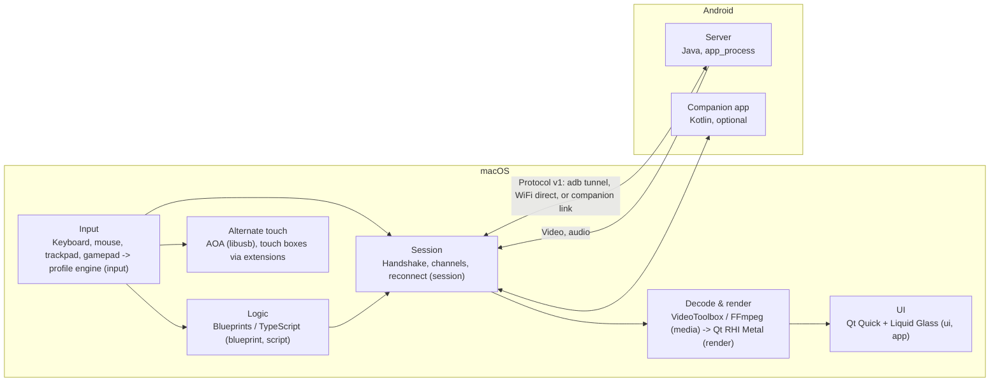

# anmacgamer Architecture

A Qt Quick app on macOS talks to a Java server on the Android phone over a shared binary protocol. Video is hardware-decoded through VideoToolbox (or dav1d for AV1) and rendered by Qt Quick on Metal. Input goes through a profile mapping engine and, when a profile has logic, through TypeScript running in QuickJS. Every module except the UI layer builds without Qt.

## Overview

## Processes

| Process | Role |
|:--|:--|
| `anmacgamer.app` | Main app: UI, device sessions, decoding and rendering, key mapping, profile logic, local MCP server, AI assistant |
| `gs` | CLI: create profile folders, type-check, replay tests, generate script SDK files, MCP stdio relay |
| `gs-exthost` | Loads native `.dylib` extensions in a separate sandboxed process so an extension crash does not bring down the app |
| `gs-scripthost` | Runs extension logic in a low-privilege `sandbox_init` process |
| Phone server | Pushed via `adb` and run under `app_process` as shell: captures screen and audio with MediaCodec, injects touch and keys, handles clipboard, app, and file operations; cleans up on disconnect |
| Companion app | Optional Android app: on-phone cursor and key hints, IME for Mac typing, QR scanning, and GSCM mirroring without adb |

External touch boxes (such as ESP32 firmware, flashing, and board protocol) live in community extensions built on the public extension API (touch methods, device providers, jobs, events, settings, panels, and hardware claims).

## macOS modules (`src/`)

Core modules are Qt-free C++20 / Objective-C++20 and build standalone with the `posix-core` preset. Only `render`, `ui`, and `app` depend on Qt.

| Module | Responsibility |
|:--|:--|
| `base` | Standard-library utilities: `Expected`, logging, clocks, endianness, SPSC queues, thread checks |
| `platform` | macOS / POSIX layer: BSD sockets, OpenSSL crypto, Keychain storage, USB via libusb (enumeration and AOA), AVFoundation / Speech TTS and voice commands, Vision OCR, input capture, sleep prevention, notifications |
| `protocol` | Binary protocol v1 codec sharing golden vectors in `protocol/vectors/` with `android/protocol` |
| `adb` | Native adb host-protocol client (device tracking, shell, push, port forwarding) speaking directly over sockets once `adb` is running |
| `session` | Device sessions: push/start server, handshake, channels, keepalive, reconnect; transports include adb tunnel, WiFi direct (UDP + FEC + reliable control), and companion link |
| `media` | FFmpeg + VideoToolbox video decoding (H.264/H.265 hardware, AV1 via dav1d) and audio decoding; playback through SDL3 |
| `render` | Qt RHI (Metal) rendering sampling NV12 / P010 / YUV 4:2:0 textures paced to display refresh |
| `input` | Input sources (keyboard, mouse, trackpad, gamepad), profile format, anchor + short-side coordinate mapping, and touch frame engine |
| `hardware` | Hardware extension points: IOKit + `termios` enumeration and I/O for `/dev/cu.*` serial ports |
| `capture` | Capture card interface and black-bar crop framework |
| `record` | Recording video, audio, and input events; MP4 export; recorded frames for vision replay |
| `vision` | Template matching, color matching, integral images, SIMD acceleration |
| `tsstrip` | Strips TypeScript type annotations so scripts run directly in QuickJS |
| `blueprint` | Two-way parser/serializer between TypeScript and blueprint nodes/wires |
| `script` | Script runtime: QuickJS-ng (one per session), API table, deterministic replay, SDK type/doc generation |
| `scripthost`, `exthost` | Sandbox subprocess protocols, Mach-O import checker, `sandbox_init` profiles, and hosts |
| `ext` | Extension manifest, versioning, dependencies, and permissions |
| `cli` | `gs` command-line tool |
| `ui` | QML modules: theme tokens (`theme`), Lucide icons (`icons`), control library (`controls`), blueprint canvas (`blueprint`) |
| `app` | Main application: native window and Liquid Glass styling, pages and view models, settings and profile storage, commands, Unix-socket MCP server, AI client, built-in help |

## Android modules (`android/`)

| Module | Notes |
|:--|:--|
| `protocol` | Java protocol implementation tested against the same golden vectors as C++ |
| `server` | Plain Java (no Kotlin stdlib); release APK is under 256 KB |
| `companion` | Kotlin companion app |

## Design rules

- Shared protocol: update `protocol/SPEC.md` and `protocol/tools/gen_vectors.py` first; both C++ and Java tests must match every golden vector byte for byte.
- No fixed-delay sync: product code avoids sleeps and delayed single-shot timers, and reads device state from server messages instead of parsing `dumpsys`/`wm`. Enforced by `tools/check_source_rules.py`.
- Threading: UI, decoding, input, and per-session logic run on separate threads; key-to-touch translation runs on the input thread so UI stalls do not delay input.
- Blueprints are code: profile logic is stored only as TypeScript (one file per control plus a library file); blueprints are an alternate view and editor over the same files.
- Data directory: settings, profiles, extensions, and logs live in `~/Library/Application Support/anmacgamer` (override with `GS_DATA_DIR`).
- Offline reproducible builds: vendored dependencies live in `third_party/` and CMake configure never accesses the network; release dylibs are built from hash-verified sources by `tools/build_macos_deps.sh`.
