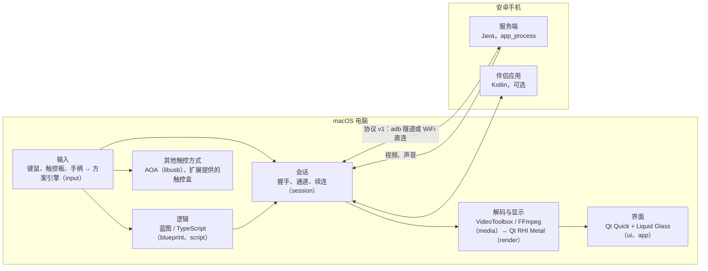

# anmacgamer 架构概览

> In short: a Qt Quick app on macOS talks to its own Java server on the phone over a binary protocol shared by both sides. Video is decoded on the GPU via VideoToolbox (or dav1d for AV1) and drawn by Qt Quick on Metal; input goes through a profile engine and, when a profile has logic, through TypeScript running in QuickJS. All modules except the interface layer build without Qt.

## 整体

## 进程

| 进程 | 作用 |
|:--|:--|
| `GameScrcpy.app` | 主程序：界面、设备会话、解码与显示、键位映射、方案逻辑、本地 MCP 服务、AI 小助手 |
| `gs` | 命令行工具：新建方案文件夹、类型检查、回放测试、生成脚本接口文件、MCP 中继 |
| `gs-exthost` | 在独立进程与 macOS 沙箱中加载原生 `.dylib` 扩展，单个扩展崩溃不影响主程序 |
| `gs-scripthost` | 在 `sandbox_init` 低权限沙箱里运行扩展带来的逻辑 |
| 手机端服务端 | 由 adb 推到手机、经 `app_process` 以 shell 身份运行：采集画面与声音并用 MediaCodec 编码、注入触控与按键、剪贴板、应用与文件操作；断开后自行清理退出 |
| 伴侣应用 | 可选装的安卓应用：手机上的光标与键位提示、输入法、扫码连接 |

外接触控盒（如 ESP32 触控盒固件、刷写与板载协议）通过社区扩展接入，只使用公开的扩展接口：触控方式、设备提供者、长任务、事件、设置、面板与串口/外设占用。

## Mac 端模块（`src/`）

核心层的模块均为不依赖 Qt 的 C++20 / Objective-C++20，可以用 `posix-core` 预设单独构建和测试；只有 `render`、`ui`、`app` 使用 Qt。

| 模块 | 职责 |
|:--|:--|
| `base` | 只用标准库的基础设施：`Expected` 错误类型、日志、时钟、字节序、单生产者单消费者队列、线程检查 |
| `platform` | macOS / POSIX 底层：BSD 套接字、OpenSSL 加密、Keychain 密钥存储、USB（libusb，用于枚举与 AOA）、语音合成与识别（AVFoundation / Speech）、Vision 识字、键鼠手柄输入捕获、防休眠与状态栏通知 |
| `protocol` | 通信协议 v1 的编解码，与安卓端 `android/protocol` 共用 `protocol/vectors/` 里的金标准测试向量 |
| `adb` | 原生的 adb 主机协议客户端：设备跟踪、shell、推送文件、端口转发；除按需启动 `adb` 服务外直接走套接字协议 |
| `session` | 设备会话：推送并启动服务端、握手、打开各个通道、保活与续连；传输方式有 adb 隧道和 WiFi 直连（画面走 UDP 加纠错，控制走轻量可靠通道） |
| `media` | 用 FFmpeg + VideoToolbox 解码视频（H.264/H.265 硬解，AV1 经 dav1d 解码）与声音，声音经 SDL3 播放 |
| `render` | 基于 Qt RHI（Metal）直接采样 NV12 / P010 / YUV 4:2:0 纹理并按屏幕刷新节拍呈现 |
| `input` | 输入源（键盘、鼠标、触控板、手柄）、方案格式 v2、坐标换算（锚点加短边单位）与把输入变成触控帧的映射引擎 |
| `hardware` | 设备扩展点：基于 IOKit 与 `termios` 枚举并读写 `/dev/cu.*` 串口设备，供触控盒等扩展使用 |
| `capture` | 采集卡接口与黑边裁切框架 |
| `record` | 录像：录下画面、声音与操作，导出 MP4，回放时提供录下的画面给识图 |
| `vision` | 识图：模板匹配、找色、积分图与 SIMD 加速 |
| `tsstrip` | 去掉 TypeScript 的类型标注，让逻辑直接在 QuickJS 里运行 |
| `blueprint` | 蓝图：把 TypeScript 解析成节点与连线、把对蓝图的编辑写回代码，两边始终是同一份内容 |
| `script` | 脚本运行时：QuickJS-ng 引擎（每个会话一个）、接口表、确定性回放、生成类型声明与接口文档 |
| `scripthost`、`exthost` | 与两个沙箱子进程通信的协议、Mach-O 导入检查、`sandbox_init` 沙箱与宿主 |
| `ext` | 扩展的清单、版本、依赖与权限 |
| `cli` | 命令行工具 `gs` |
| `ui` | QML 模块：设计令牌（`theme`）、图标（`icons`，由 Lucide 生成）、组件库（`controls`）、蓝图画布（`blueprint`） |
| `app` | 主程序：原生窗口与 Liquid Glass 外观、页面与视图模型、设置与方案存储、命令系统、本地 Unix 套接字 MCP 服务、AI 服务、内置帮助 |

## 安卓端（`android/`）

| 模块 | 说明 |
|:--|:--|
| `protocol` | 协议的 Java 实现，测试读取与 C++ 相同的金标准向量 |
| `server` | 服务端，纯 Java（不带 Kotlin 标准库）；发布版 APK 不到 256 KB |
| `companion` | 伴侣应用，Kotlin |

## 几条贯穿全局的设计

- **协议两端一致**：协议改动先改 `protocol/SPEC.md`，再改向量生成器 `protocol/tools/gen_vectors.py`，C++ 与 Java 两边的测试都要逐字节通过。
- **不靠固定延时同步**：产品代码里不 sleep、不用带延时的单发定时器；设备状态来自服务端的消息，而不是解析命令输出。源码规则检查（`tools/check_source_rules.py`）会拦下这两类写法。
- **线程**：界面、解码、输入与每个会话的逻辑各在自己的线程；按键到触控帧在输入线程上完成，不受界面卡顿影响。
- **蓝图就是代码**：方案逻辑只存 TypeScript（每个键位一个文件、函数库一个文件），蓝图是它的另一种显示与编辑方式，不另存一份图。
- **数据位置**：设置、方案、扩展与日志保存在 `~/Library/Application Support/GameScrcpy`（可通过环境变量 `GS_DATA_DIR` 指定独立目录）。
- **离线可复现构建**：源码内第三方依赖固定版本放在 `third_party/`，配置阶段不联网；发布版动态库由 `tools/build_macos_deps.sh` 从校验过哈希的固定源码构建。
